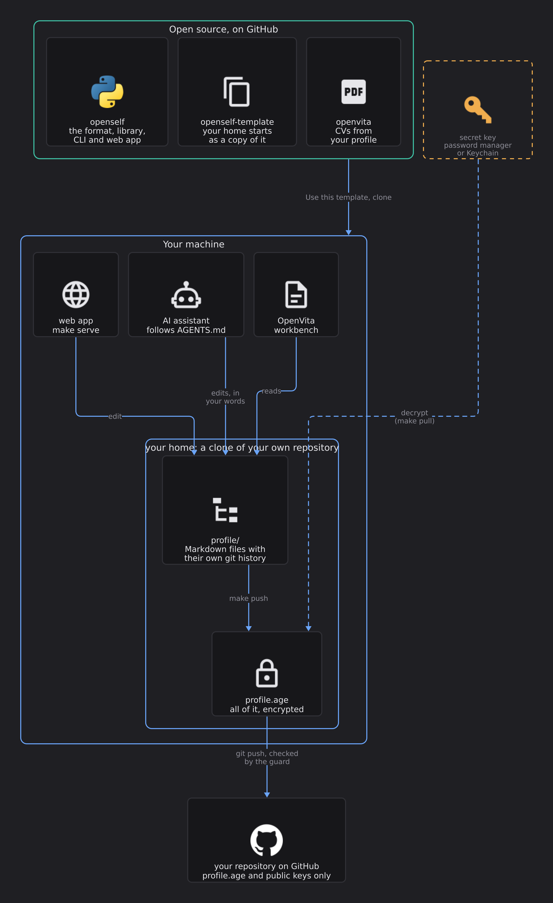

# OpenSelf

**[Documentation](https://mortennordbye.github.io/openself/)** ·
[Getting started](https://mortennordbye.github.io/openself/getting-started/) ·
[The format](SPEC.md)

An open file format for everything about a person: who they are, what they have done, and where
they show up online. A profile is a plain folder of Markdown files with structured frontmatter,
in its own git repository, owned by the person it describes. Any tool can read it: a CV builder,
a form filler, a search, an AI assistant.

Schema 1 covers the career: person, employments, assignments, certifications and education.
Identity, accounts, projects, publications and credentials are meant to follow as new entry types
in later schema versions, in the same shape.

- **Readable by AI.** One small file per entry, a generated `INDEX.md` with the whole profile on
  one page, and stable ids an assistant can grep, open and cite instead of reading everything.
- **Owned and honest.** Only the owner adds facts, in their own words. Every entry says where its
  facts come from and how sure they are. Open questions and conflicts are flags, not guesses.
- **Versioned.** Every change is a git commit with who made it. Nothing is rewritten: an old
  version comes back as a new commit, and the whole profile can be read as it was on any date.
- **Portable.** A profile refers to nothing outside its folder, so it can live anywhere: a local
  folder, a submodule, an encrypted backup.

See [SPEC.md](SPEC.md) for the format and [example/](example/) for a complete fictional profile.

## How the pieces fit

[](docs/assets/diagrams/ecosystem-overview.png?raw=1)

> **Click to open the full-size image.** Rendered by `make diagram` from
> [this file](docs/assets/diagrams/ecosystem-overview.d2).

OpenSelf is three repositories and one of your own: **openself** (this one: the format, library
and web app), **[openself-template](https://github.com/mortennordbye/openself-template)** (the
starting point for your own repository, your *home*, which keeps the profile encrypted) and
**[openvita](https://github.com/mortennordbye/openvita)** (CVs from the profile).

**Start here:** [Getting started](https://mortennordbye.github.io/openself/getting-started/)
takes you from nothing to your own encrypted profile on GitHub.

## The web app

```
python3 -m openself serve path/to/profile
```

opens a local web app (127.0.0.1 only) to read and edit a profile. It opens on an overview: the
career as a stream, newest first, with each assignment opening in place under its employment, a
compact timeline, the most used technology (click one to show only where it was used) and the open
questions. Beside it are a full timeline, technology with the assignments that show it, and the open
questions and gaps. You can edit fields and text, add and remove entries, answer questions, see every change with
a word diff, restore an old version and view the profile as it was on any date. Everything you save
is a commit. It works in English and Norwegian, following the profile's language.

**An assistant next to it.** "Ask about this" on an entry, "Ask me about this" on an open question,
and "Save and ask me" on a new entry store a request for an assistant such as Claude Code. Run

```
python3 -m openself assistant watch path/to/profile
```

as a background monitor in the assistant's session (in a home folder, `make ai` starts Claude Code
already told to). It prints each request, and the AI chip in the header turns green while it runs.
The assistant interviews you in its own window, writes your answers into the profile in your words,
and marks the request done (`openself assistant done N --note "..."`). Requests are kept in the
profile's `.git` folder, so they are never committed or pushed.

```
python3 -m openself import path/to/profile https://www.credly.com/users/<you> --dry-run
```

imports certifications from a public Credly profile or Microsoft Learn transcript link (Profile →
Transcript → Share link) into `certifications.md`: new rows are added, empty cells filled, and a
date that disagrees becomes a conflict for you to resolve. The links are kept, so next time
`openself import path/to/profile` is enough. The web app has the same as an Import button on the
certifications. Certificate issuers show their logo: bundled ones are from
[Simple Icons](https://simpleicons.org) (CC0); for brands whose logos are not freely licensed
(Microsoft, AWS, Oracle, Forsvaret) the page loads the icon from their own website.

## Your own profile repository, encrypted

A profile is personal. To keep it in a GitHub repository, even a public one, keep it encrypted.
The quickest start is [openself-template](https://github.com/mortennordbye/openself-template)
(**Use this template**, then follow its README). By hand:

```
mkdir my-openself && cd my-openself
python3 -m openself home         # .openself/, a .gitignore that keeps profile/ out, git init
python3 -m openself keys         # makes this machine's age key (post-quantum), adds it as a recipient
python3 -m openself serve        # create and edit the profile in ./profile
python3 -m openself push         # encrypt all of it, history included, into profile.age; commit; push
python3 -m openself pull         # on another machine: fetch, decrypt, fast-forward ./profile
```

Only `profile.age`, `.openself/recipients` (public keys) and `.gitignore` are committed. The
decrypted profile stays local. `profile.age` holds the whole profile repository, every version, so
history and restore work on every machine; GitHub sees one opaque file, padded to 64 KiB steps,
and when it changes. The secret key lives in the macOS Keychain (elsewhere in
`~/.config/openself/identity.txt`, readable only by you) and reaches `age` through a pipe, never
a file. **Back it up**, for example in a password manager: without it the profile cannot be read.
Add another machine or person by adding their age public key to `.openself/recipients` and pushing.

To keep the key only in a password manager, put a command that prints it in
`~/.config/openself/identity-command` (or `OPENSELF_IDENTITY_COMMAND`). With Bitwarden, store the
key as a secure note and use `bw get notes "OpenSelf age key"`; unlock first with
`export BW_SESSION=$(bw unlock --raw)` in the shell that runs `openself`, or let it ask: when the
vault is locked and `openself` runs in a terminal, it asks for the master password itself.
`openself keys --bitwarden` moves an existing key there in one go: it saves the note, checks that
what Bitwarden returns opens the profile, sets up the command, and offers to delete the Keychain
copy.

### Vaults: any other files, encrypted the same way

A home can keep more than the profile. A *vault* is a folder of any files (documents, images,
PDFs, CVs, notes), versioned with git and pushed encrypted next to the profile:

```
python3 -m openself vault add cv     # cv/ (a git repository, kept out of the home's git), listed in .openself/config
cp ~/Downloads/*.pdf cv/             # anything
python3 -m openself push             # cv/ is committed and encrypted into cv.age, every version
python3 -m openself pull             # on another machine: profile/ and cv/ come back
python3 -m openself vault list       # each vault, and whether it has changes to push
```

Each vault is its own `<name>.age`, in the same format as `profile.age`, so only the vault that
changed is uploaded again. GitHub refuses files over 100 MB, so push stops before a vault gets
there; split large collections into more vaults. Every version stays in the history (and in the
public history of the encrypted file), so a vault suits documents you keep, not media you churn.

A home never publishes plaintext: `openself guard` runs as git pre-commit and pre-push hooks
(installed by every push and pull) and on every outgoing commit before each upload, and refuses
anything from `profile/` or a vault folder, any unexpected file, an allowed file that quotes the profile (your name,
email, phone, employers, customers), an unencrypted `profile.age` or vault file, or anything but public keys in
the recipients. It fails closed: what it cannot read, it refuses.

A key that shows up in `.openself/recipients` (with a pull, say) is not used until you approve it
on this machine: push stops and lists it. Run `openself trust` to approve a key that is yours, for
example a new machine's; otherwise remove it. `openself guard --history` checks every commit, which
the template runs in CI so a bad push at least turns red.

For a home on GitHub, lock `main` with a ruleset (pull request and the `guard` check required,
no direct or force pushes) and put `push = pull-request` in `.openself/config`: push then opens a
pull request that merges by itself once the guard passes (needs the `gh` CLI and auto-merge
switched on for the repository).
Pushing only needs the public keys, so an AI can encrypt and push changes without access to the
secret key; decrypting stays with you.

Needs [age](https://age-encryption.org) 1.3 or newer for post-quantum keys (`brew install age`);
older versions fall back to classic keys.

Things a public encrypted repository still shows: that it exists, when you push, and the size
in 64 KiB steps. Encrypted files in public history stay there for good, so a key that leaks later
opens every old version. Keep the key safe, and use a private repository if that matters more
than reach.

## openself, the library

`openself/` is the reference library and command line tool. Python 3.10 or newer, standard
library only.

```
python3 -m openself init my-profile --owner "Kari Nordmann" --lang nb,en
python3 -m openself new my-profile employment employer="Acme AS" title=Utvikler start=2024-01 end=ongoing
python3 -m openself lint my-profile
python3 -m openself log my-profile
python3 -m openself export my-profile     # the public view, as JSON, for a CV or a site
```

Run it from this folder, or add the repository to another project and put it on `PYTHONPATH`:

```
git submodule add https://github.com/mortennordbye/openself.git openself
PYTHONPATH=openself python3 -m openself lint path/to/profile
```

Tests: `python3 -m unittest discover -s tests`. Changes to the format are listed in
[CHANGELOG.md](CHANGELOG.md); section 6 of the spec says how versions work.

## License

[MIT](LICENSE).
