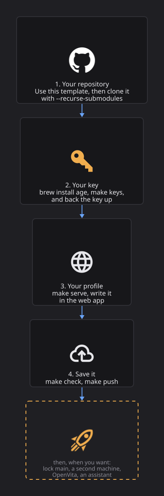

# Getting started

From nothing to your own profile, encrypted on GitHub. You need a GitHub account and a Mac or
Linux machine.

[](assets/diagrams/onboarding.svg)

## What you need

| | |
|---|---|
| Python 3.10 or newer | `python3 --version`. The tools use only the standard library. |
| git | Any recent version. |
| [age](https://age-encryption.org) 1.3 or newer | `brew install age`, or a release from [GitHub](https://github.com/FiloSottile/age/releases). 1.3 gives post-quantum keys; older versions fall back to classic keys. |
| A password manager | To back up your key. Optional, but losing the key means losing the profile. |
| Docker | Only for OpenVita, which renders PDFs in a container. |

## 1. Make your repository

On [openself-template](https://github.com/mortennordbye/openself-template), click **Use this
template** and create your repository. Public is fine: it will only ever hold the encrypted file.
Then clone it with the framework inside:

```sh
git clone --recurse-submodules git@github.com:<you>/<your-repo>.git
cd <your-repo>
```

This folder is your *home*. Everything below runs in it. `make` on its own lists every command.

!!! note "Cloned without `--recurse-submodules`?"
    Run `git submodule update --init` once.

## 2. Make your key

```sh
make keys
```

This makes an age key for this machine and adds its public half to `.openself/recipients`. On
macOS the secret half goes in the Keychain; elsewhere in `~/.config/openself/identity.txt`,
readable only by you.

!!! warning "Back the key up now"
    Without it nobody, including you, can read the profile again. Put it in your password manager.
    With Bitwarden, `make bitwarden` does it in one go: it saves the key as a secure note, checks
    that it opens the profile, and from then on openself reads it from there. See
    [Your key](concepts/sync.md#your-key).

## 3. Write your profile

```sh
make serve
```

opens the web app on `http://127.0.0.1:8765`. The first time, it asks for your name and language
and creates `profile/`. Add your jobs (employments) and what you did in them (assignments),
certifications and education. Every save is a commit.

Write in your own words. Where you are unsure, leave a flag (`⚑ question: ...`) instead of
guessing; the app lists open flags under questions and gaps. To see what a full profile looks like,
browse the [fictional example](https://github.com/mortennordbye/openself/tree/main/example).

Want help? [Let an AI assistant interview you](ai.md).

## 4. Check and save

```sh
make check    # the guard and the profile lint; prompts are open questions, not errors
make push     # encrypt profile/ into profile.age, commit, push
```

`make push` packs the whole profile, every version, into `profile.age`, encrypted to the public
keys, and pushes it. GitHub now has one opaque file. That is it: you have a profile you own.

## Next steps

- **Lock `main`** so GitHub refuses anything that has not passed the guard, even from you:
  [Lock main](concepts/sync.md#lock-main).
- **A second machine:** see [On a new machine](concepts/sync.md#on-a-new-machine).
- **CVs:** [OpenVita](openvita.md) builds them from the profile.
- **Documents and images:** `make vault NAME=docs` keeps any files encrypted next to the profile.
  See [Vaults](concepts/sync.md#vaults).
- **Updates:** the framework is a submodule pinned to a version. To move to a newer one:
  `git submodule update --remote openself`, then commit. Your profile is never touched; format
  changes come with a migration.

## Day to day

| Command | What it does |
|---|---|
| `make serve` | The web app: edit, history, the profile as of a date |
| `make pull` | Download and decrypt (needs your key) |
| `make push` | Check, encrypt and upload (needs only the public keys) |
| `make check` | The guard and the profile lint |
| `make ai` | Start Claude Code watching the web app's requests |
| `make vault NAME=docs`, `make vaults` | Make a vault, list vaults with changes |
